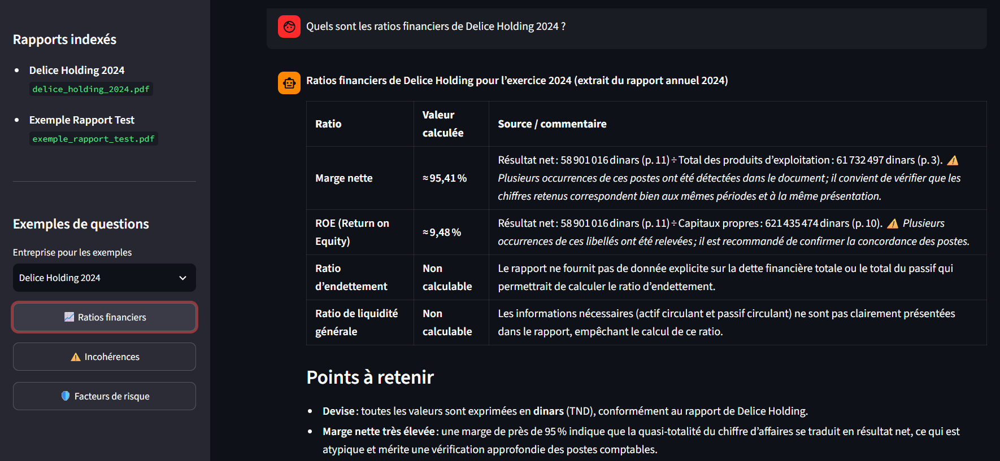

# FinAgent — un agent IA pour lire des rapports financiers

FinAgent répond à des questions sur des rapports financiers publics (rapports annuels de sociétés cotées à la BVMT, 10-K…). Il retrouve les passages utiles du document, calcule des ratios, repère les chiffres incohérents entre deux pages et résume les facteurs de risque, en citant à chaque fois la source et la page.

**Démo en ligne :** [ouvrir FinAgent sur Streamlit](https://fin-agent-afbig5pchzesc8cuea4pws.streamlit.app/)
(hébergée sur la version gratuite de Streamlit : si l'app est en veille, le premier chargement prend une trentaine de secondes)



---

## Ce qu'on peut lui demander

- **Une question libre** sur un rapport : *« Quel est le résultat net de l'exercice ? »*
- **Les ratios financiers** : marge nette, ROE, taux d'endettement, liquidité générale
- **Les incohérences** : un même chiffre qui ne vaut pas la même chose à deux endroits du rapport
- **Les facteurs de risque**, résumés en quelques points avec la page source
- **Un filtre par entreprise** : quand la question cite une société, l'agent ne cherche que dans son rapport

## Exemple

Sur le rapport annuel 2024 de **Délice Holding** :

> **Question :** Quel est le résultat net de l'exercice ?
>
> **Réponse :** Résultat net 2024 : 58 901 016 dinars (2023 : 34 430 924 dinars), avec la page du rapport d'où vient le chiffre.

Les ratios et les risques sont rendus sous forme de tableaux, chaque ligne renvoyant au document et à la page utilisés.

## Comment ça marche

```
Rapports PDF
     │
     ▼
Extraction du texte (PyMuPDF) ─► Découpage en morceaux ─► Embeddings ─► ChromaDB
                                                                          │
                                                                          ▼
                                   Agent LangChain (tool-calling via Groq)
                                                  │
              ┌──────────────────┬────────────────┼──────────────────┐
              ▼                  ▼                ▼                  ▼
      Recherche de       Ratios financiers   Incohérences       Résumé des
        contexte          (calcul Python)   (calcul Python)    risques (LLM)
                                                  │
                                                  ▼
                          Interface Streamlit · API FastAPI · Serveur MCP
```

- **L'agent choisit lui-même son outil.** Il n'a aucun contexte au départ : il appelle l'outil adapté à la question, et chaque outil va chercher ses propres passages dans ChromaDB.
- **Les ratios et les incohérences sont calculés en Python, pas par le LLM.** Les montants sont extraits du texte par des expressions régulières (formats français et anglais, millions et milliers, colonne N-1…). Le résultat est donc vérifiable, et si une donnée manque, l'outil le dit au lieu d'inventer un chiffre.
- **Seul le résumé des risques** et la mise en forme de la réponse passent par le LLM.
- **Les mêmes outils sont exposés via un serveur MCP**, ce qui permet de les brancher sur d'autres clients compatibles.

## Stack

Python · LangChain (`create_agent`) · Groq (`openai/gpt-oss-120b`) · ChromaDB · sentence-transformers (`all-MiniLM-L6-v2`) · PyMuPDF · Streamlit · FastAPI · MCP

## Lancer le projet en local

```bash
git clone https://github.com/mohamed15032003/fin-agent.git
cd fin-agent
python -m venv venv
venv\Scripts\activate        # Linux / macOS : source venv/bin/activate
pip install -r requirements.txt
cp .env.example .env         # puis mettre sa clé GROQ_API_KEY dans .env
streamlit run streamlit_app.py
```

Au premier lancement, l'application indexe automatiquement les rapports de `data/raw/` (environ 1 minute), puis les lancements suivants sont immédiats.

Autres points d'entrée :

```bash
python -m src.rag.agent "Quels sont les ratios financiers de Délice Holding ?"   # en ligne de commande
uvicorn src.api.main:app --reload                                              # API : GET /health, POST /ask
python -m src.mcp.server                                                        # serveur MCP
```

## Ce que j'ai appris en le construisant

- **Un petit document peut être « noyé » par un gros.** Quand le contexte était pré-chargé pour toutes les questions, le rapport de test (2 morceaux) disparaissait derrière celui de Délice (74 morceaux). J'ai retiré ce pré-chargement et ajouté un paramètre `company` aux outils pour cibler un seul rapport.
- **Les modèles et les SDK bougent vite.** Le modèle Llama 3.3 utilisé au départ a été retiré par Groq en août 2026, et le SDK MCP a renommé sa classe principale entre la v1 et la v2. J'ai dû adapter le code dans les deux cas.
- **Extraire des chiffres d'un PDF est plus dur qu'il n'y paraît** : espaces dans les nombres, unités, années à ne pas confondre avec des montants, colonnes de l'année précédente… La majeure partie du travail sur les ratios est là.
- **Déployer, c'est penser au premier lancement.** L'index ChromaDB n'est pas versionné : l'application le reconstruit seule quand il est vide, sans aucune étape manuelle.

## Limites et prochaines étapes

- Le découpage du texte est simple (taille fixe avec chevauchement). Un découpage qui respecte la structure du rapport donnerait de meilleurs passages.
- L'extraction des chiffres repose sur des règles : un rapport avec une mise en forme inhabituelle peut faire échouer un ratio (l'outil l'indique alors comme « non calculable »).
- L'évaluation n'est pas encore faite : la prochaine étape est un jeu de questions de référence pour mesurer la qualité de la recherche et la fidélité des réponses aux documents.
- Seuls deux rapports sont indexés pour l'instant ; l'objectif est d'en ajouter d'autres sociétés cotées à la BVMT.

---

Projet personnel réalisé par **Mohamed Derbel**, élève ingénieur en ingénierie financière à ESPRIT.
[LinkedIn](https://www.linkedin.com/in/mohamed-derbel-financial-it-student) · [GitHub](https://github.com/mohamed15032003)
